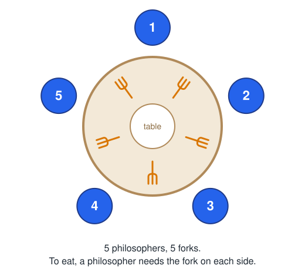
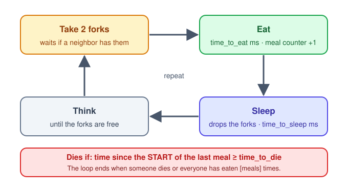
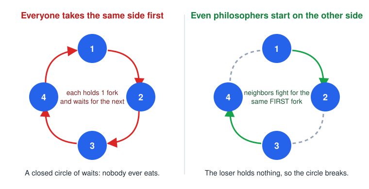
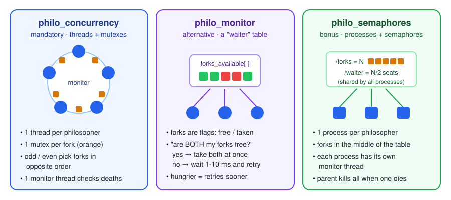

# 🍝 Philosophers: Threads, Mutexes and Semaphores

<p align="center">
  
</p>

<p align="center">
  <a href="https://www.youtube.com/watch?v=ybDhEvwDe90&t=10s" target="_blank" rel="noopener noreferrer">
    Pantheon: Dining Philosophers Problem
  </a>
</p>


## 📖 Description

Philosophers is my solution to the Dining Philosophers problem, written in C. I made it to learn concurrent programming: how to run several things at the same time, how to share data between them safely, and how to avoid data races and deadlocks.

> **In simple terms:** a few philosophers sit at a round table with a bowl of spaghetti. There is one fork between each pair of them, and you need two forks to eat. They eat, sleep and think in a loop, and if one of them goes too long without eating, they die. The program has to organize the dinner so nobody starves.

<p align="center">
  
</p>

Each philosopher is a thread (a process in the bonus), and each fork can only be held by one philosopher at a time.

---

## 🧠 Concepts Step by Step

First the rules, then threads and shared data, then deadlocks, and last how the program notices that someone died.

### 🍴 1. The Rules

```bash
./philo number_of_philosophers time_to_die time_to_eat time_to_sleep [meals]
```

| Argument | Meaning |
| --- | --- |
| `number_of_philosophers` | Philosophers at the table. There are as many forks. Max 200. |
| `time_to_die` | Milliseconds a philosopher can go without eating. |
| `time_to_eat` | Milliseconds it takes to eat, holding 2 forks. |
| `time_to_sleep` | Milliseconds spent sleeping. |
| `meals` *(optional)* | If everyone eats this many times, the dinner ends. |

All arguments must be positive integers, and the times must be at least 60 ms.

<p align="center">
  
</p>

Each line of output has the time in ms since the start, the philosopher's number, and what they did:

```text
The dinner has started
1       1       has taken a fork
1       1       has taken a fork
1       1       is eating
201     3       has taken a fork
201     3       has taken a fork
201     3       is eating
401     2       has taken a fork
401     2       has taken a fork
401     2       is eating
All philosophers have eaten enough
The dinner has ended
```

The subject adds two rules that make it harder:
- A death has to be printed at most 10 ms after it happens.
- After a death, nothing else can be printed.

---

### 🔄 2. The Life of a Philosopher

Every philosopher repeats the same loop:

<p align="center">
  
</p>

The death timer starts when a philosopher starts eating, not when they finish. Each philosopher stores the time of their last meal, and someone has to check it often enough to catch a death in time (part 5).

---

### 🧵 3. Threads and Data Races

A thread is a line of execution inside the program. All threads share the same memory, so they can talk to each other easily, but they can also step on each other.

Say the monitor reads a philosopher's meal counter while the philosopher is updating it:

```text
  Philosopher thread              Monitor thread
  ------------------              --------------
  reads meals = 2
                                  reads meals = 2
  writes meals = 3
                                  "only 2 meals, still hungry"   <-- old value
```

That is a data race: two threads use the same data at the same time and at least one of them writes it. What you get depends on timing.

A mutex (mutual exclusion) fixes it. It is a lock that only one thread can hold. Before touching the data, a thread locks the mutex, and any other thread that tries to lock it waits until it is unlocked.

```c
pthread_mutex_lock(&philo->meal_mutex);
philo->starvation = get_timestamp(philo->dinner->start);
philo->meals++;
pthread_mutex_unlock(&philo->meal_mutex);
```

Each piece of shared data has its own mutex:

| Mutex | Protects |
| --- | --- |
| `fork_mutex`, one per fork | The fork. Only one philosopher can hold it. |
| `meal_mutex`, one per philosopher | Time of the last meal and number of meals. |
| `end_mutex` | The `stop` flag that tells everyone the dinner is over. |
| `print_mutex` | The output, so two messages never get mixed. |

---

### 🔒 4. Deadlock

Mutexes fix data races but bring a new problem. What if every philosopher picks up the fork on their left at the same moment?

<p align="center">
  
</p>

Each of them holds one fork and waits for the second one, which the neighbor has. Nobody lets go, so they wait forever. That is a deadlock.

To avoid it, philosophers don't all take forks in the same order:

- Odd philosophers take their own fork first, then their neighbor's.
- Even philosophers do the opposite.

This way two neighbors go for the same fork first. One gets it, and the other waits with empty hands, so the circle can't close.

Even philosophers also wait `time_to_eat / 2` ms before their first meal, so the odd ones eat first and everyone doesn't start fighting for forks at once.

---

### 👀 5. The Monitor: Catching Deaths in Time

Philosophers are busy eating and sleeping, so another thread, the monitor, checks on them. Every 5 ms it goes around the table and checks each philosopher:

```text
now - last_meal >= time_to_die ?
```

- If yes, it prints `died` and sets `stop = TRUE`. Philosophers check `stop` on every loop and leave when it is set.
- If everyone has eaten `[meals]` times, it ends the dinner. A philosopher who has already eaten enough is not checked anymore, so they can't be reported as dead.

#### Nothing after "died"

Philosophers check `stop` while holding the print lock:

```c
pthread_mutex_lock(&philo->dinner->print_mutex);
if (!safe_read_end(philo->dinner))
    printf("%u\t%d\t%s", get_timestamp(start_time), philo->id, msg);
pthread_mutex_unlock(&philo->dinner->print_mutex);
```

The monitor holds that same lock while it sets `stop` and prints `died`. Anyone who prints after that sees `stop = TRUE` and prints nothing.

> The locks are always taken in the same order: first `print`, then `end`. If two threads took them in opposite orders, each could end up waiting for the other, which is another deadlock.

#### One philosopher

There is only one fork on the table. The philosopher takes it, waits `time_to_die` ms and dies without ever getting a second fork.

---

### 🧩 6. Three Versions

I wrote the project three times, each with a different way of handing out forks:

<p align="center">
  
</p>

#### `philo_concurrency` (mandatory)
What parts 3 to 5 describe: one thread per philosopher, one mutex per fork, odd/even fork order, and a monitor thread.

#### `philo_monitor` (alternative)
Here forks are not mutexes. They are flags (`FREE` / `TAKEN`) in a table protected by a single mutex, like a waiter who keeps track of the forks. A philosopher asks whether both of their forks are free:
- If they are, the philosopher takes both at once. Nobody ever holds a single fork, so there can't be a deadlock.
- If not, they wait a bit and ask again. The hungrier they are, the sooner they ask, from every 10 ms down to every 1 ms.

#### `philo_semaphores` (bonus)
Each philosopher is a process instead of a thread. Processes don't share memory, so a mutex in one process means nothing to the others. They use named semaphores instead, which belong to the operating system and any process can open.

A semaphore is a counter. `sem_wait` takes one from it (and waits if it is at 0), and `sem_post` puts one back. A mutex works like a semaphore that only goes up to 1.

- `/forks` starts at N. The forks are all in the middle of the table and a philosopher takes any two.
- `/waiter` starts at N/2. You need one of these seats before taking forks. Without it, every philosopher could take one fork and wait for a second that never comes, which is the same deadlock as before. With N/2 seats, anyone who sits down finds two forks.
- `/print` does the job of the print mutex. When a philosopher dies, their process never releases it, so nobody can print after `died`.

Each process has its own monitor thread that watches only that philosopher. The parent process waits for its children:
- If one of them exits because it died, the parent kills the rest.
- If all of them exit after eating enough, the dinner went well.

Semaphores don't decide who goes first. A philosopher who just finished eating can get a seat before one who has been waiting longer. To prevent that, philosophers think for a while before asking again:

$$
t_{think} = \frac{t_{die} - t_{eat} - t_{sleep}}{2}
$$

That is half of the spare time they have, so it never puts them at risk, and it lets the hungriest ones sit down first.

---

## 🕹️ Instructions

### Compilation
Each version has its own folder and Makefile:
```bash
git clone https://github.com/LordMikkel/Philosophers.git
cd Philosophers/philo_concurrency     # or philo_monitor
make                                  # builds ./philo

cd ../philo_semaphores
make                                  # builds ./philo_bonus
```

### Run
```bash
./philo 5 800 200 200        # nobody dies, runs until you stop it
./philo 5 800 200 200 7      # stops when everyone has eaten 7 times
./philo 4 410 200 200        # nobody dies, tight timing
./philo 4 310 200 100        # one philosopher dies
./philo 1 800 200 200        # dies, there is only one fork
```

### Testing
Tools I used to look for data races, deadlocks and leaks:
```bash
valgrind --leak-check=full ./philo 4 410 200 200 3      # memory leaks
valgrind --tool=helgrind ./philo 4 800 200 200 3        # data races and lock order
cc -fsanitize=thread -pthread src/*.c -Iinc -o philo    # build with ThreadSanitizer
```

---

## 📚 Resources
- [Dining philosophers problem (Wikipedia)](https://en.wikipedia.org/wiki/Dining_philosophers_problem) - The original problem, proposed by Edsger Dijkstra.
- [CodeVault](https://www.youtube.com/watch?v=oq29KUy29iQ&t=187s) - YouTube channel with clear videos about threads, mutexes, semaphores and processes in C. This one explains mutexes.
- [pthreads(7)](https://man7.org/linux/man-pages/man7/pthreads.7.html) - How POSIX threads work on Linux.
- [sem_overview(7)](https://man7.org/linux/man-pages/man7/sem_overview.7.html) - Named and unnamed POSIX semaphores.

---

## ✍️ Credits

I'm Mikel Garrido, a student at 42 Barcelona. I always try to build the simplest and most solid version of every project. I hope this guide helps you!

[](https://profile.intra.42.fr/users/migarrid)
